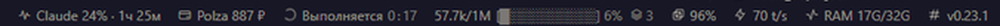

# hermes-polza-balance

Баланс [Polza.ai](https://polza.ai) в статус-баре десктопного Hermes Agent. Чип `Polza 888 ₽` справа внизу, цвет меняется от нейтрального к красному по мере того, как деньги заканчиваются.



*English: a Hermes Desktop status-bar chip that shows your Polza.ai balance and turns red as it approaches 100 RUB.*

## Зачем

Polza работает как роутер: запросы к моделям списывают рубли, и баланс кончается посреди рабочей сессии. Проверять его в личном кабинете приходится вручную. Плагин держит сумму перед глазами и заранее предупреждает цветом.

- от 500 ₽ вниз чип плавно краснеет: на 300 ₽ красного 50%, на 100 ₽ и ниже он полностью красный с иконкой ⚠;
- клик по чипу обновляет баланс сразу, иначе он обновляется раз в 2 минуты;
- тултип показывает точную сумму, доступный остаток, резерв и время обновления.

## Безопасность ключа

Ключ читает Python-бэкенд плагина на твоей машине и отправляет только на `https://polza.ai/api/v2/balance`. Окну приложения уходят одни цифры. Ключ никуда не логируется и не сохраняется. Код небольшой (`dashboard/plugin_api.py`, `desktop/plugin.js`), прочитать его можно за пять минут.

## Установка

Нужен Hermes Desktop и API-ключ Polza.ai.

```bash
hermes plugins install degin/hermes-polza-balance --enable
```

Дальше два переключателя, оба по умолчанию выключены (так устроена безопасность плагинов Hermes):

1. `plugins.enabled` в конфиге. Флаг `--enable` выше уже поставил его. Без флага выполни `hermes plugins enable polza-balance`.
2. В приложении: Capabilities → Plugins → включить «Polza balance» (десктопная часть).

Если чип не появился: `Ctrl+K` → «Reload desktop plugins», затем перезапусти gateway.

## Ключ

Плагин объявляет `requires_env: POLZA_API_KEY` и читает ключ через `agent.secret_scope.get_secret`, то есть по правилам Hermes для секретов (учитывает активный профиль). При установке Hermes спросит ключ. Можно добавить строку `POLZA_API_KEY=...` в `.env` профиля. Ключ берётся в личном кабинете Polza.ai.

## Что делает плагин с сетью и данными

- Один запрос `GET https://polza.ai/api/v2/balance` с заголовком `Authorization: Bearer <ключ>`, не чаще раза в минуту.
- Читает только `POLZA_API_KEY` через Hermes. Файлов `.env` и других хранилищ не открывает, ничего не записывает на диск.
- Нет фоновых процессов, телеметрии, shell-команд и самообновления.

## Настройка порогов

В начале `desktop/plugin.js`:

```js
const WARN_FROM = 500 // ₽: с этого значения начинается покраснение
const RED_AT = 100    // ₽: на этом и ниже цвет полностью красный
```

После правки: `Ctrl+K` → «Reload desktop plugins».

## Если не работает

| Что видно в чипе | Причина |
|---|---|
| `Polza —`, тултип «Нет ключа Polza» | ключ не найден под одним из имён выше |
| `Polza —`, `http_401` | ключ неверный или отозван |
| `Polza —`, `network` | нет связи с polza.ai |
| чипа нет совсем | не включён один из двух переключателей, либо не перезапущен gateway; ошибки смотри в `hermes logs gateway` |

Плагин использует `GET /api/v2/balance` ([документация Polza](https://polza.ai/docs/api-reference/other/balance-v2.md)). Поле `amount` показывает баланс организации, а `available` показывает, сколько ты можешь потратить сейчас.

## Лицензия

MIT.
